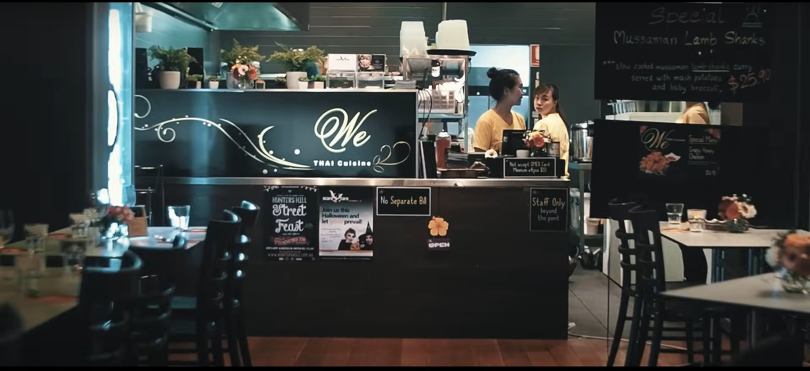

# MH29 Restoran

A responsive multi-page restaurant website built with HTML, CSS, Bootstrap, and JavaScript. The site presents a restaurant brand, menu, services, team, contact information, and table-booking experience in a warm, food-focused design.

## Preview



## Highlights

- Responsive layout for desktop, tablet, and mobile screens
- Restaurant homepage with hero section, featured dishes, services, testimonials, and calls to action
- Dedicated pages for:
  - About
  - Menu
  - Services
  - Team
  - Booking
  - Contact
- Bootstrap-based navigation, layout, buttons, cards, and responsive components
- Local image assets for the hero, food menu, restaurant story, team, and promotional sections
- Interactive navigation and UI behavior powered by jQuery and the project JavaScript files

## Technology

- HTML5
- CSS3
- Bootstrap
- JavaScript
- jQuery
- Font Awesome
- Owl Carousel assets

## Run locally

This is a static website, so no build step or backend is required.

1. Clone the repository:

   ```bash
   git clone https://github.com/VinayakAsole/restorent-website.git
   cd restorent-website
   ```

2. Open `index.html` in a browser.

   For a local development server, run:

   ```bash
   python -m http.server 8000
   ```

   Then visit <http://localhost:8000>.

## Project structure

```text
.
├── index.html          # Homepage
├── about.html          # Restaurant story and information
├── menu.html           # Food and drink menu
├── service.html        # Restaurant services
├── team.html           # Team page
├── booking.html        # Table booking page
├── contact.html        # Contact page
├── css/                # Bootstrap and custom styles
├── js/                 # Site interactions
├── img/                # Food, restaurant, team, and preview images
└── lib/                # Third-party frontend assets
```

## Customization

- Update restaurant text, contact details, and links in the HTML pages.
- Replace images in `img/` while keeping the filenames referenced by the pages, or update the image paths in the markup.
- Adjust colors, typography, spacing, and responsive behavior in `css/style.css`.
- Add or update interactive behavior in `js/main.js`.

## License

This project is provided for learning and portfolio use. Review the licenses of any third-party assets before redistributing the project.
